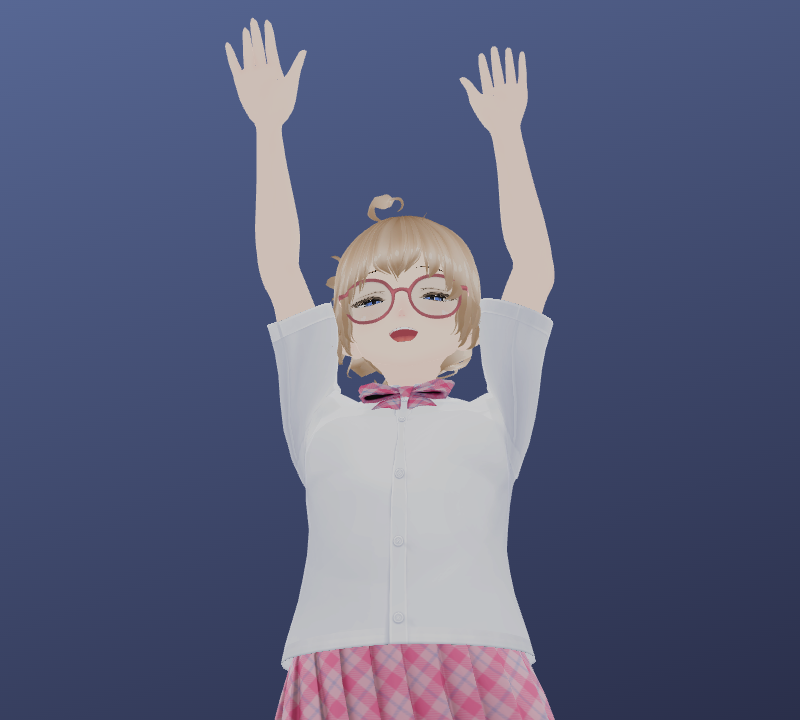
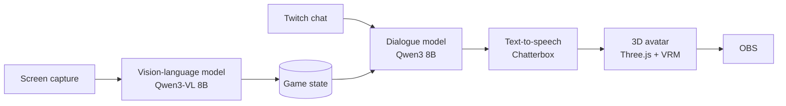
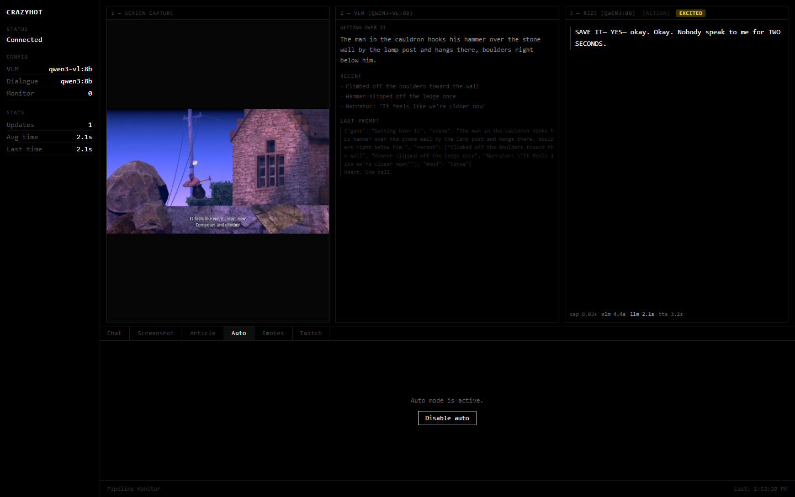
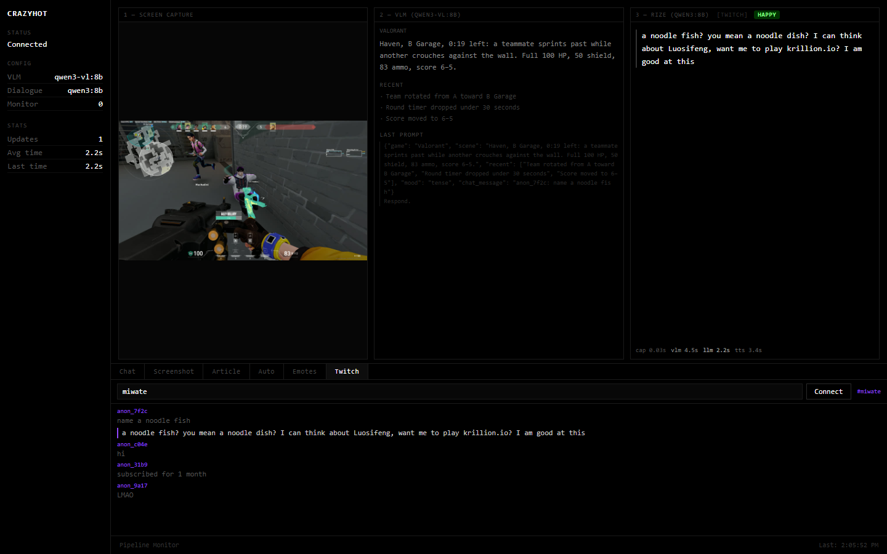
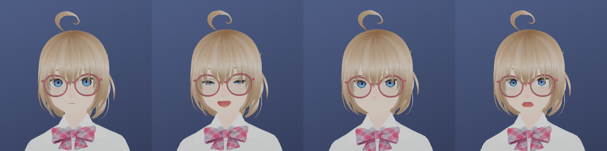

# Livestreaming Agent

A local AI agent for game streaming. It watches the screen, describes what is happening with a vision-language model, and comments out loud through an animated 3D avatar. The avatar renders in a browser window and is captured by OBS as an overlay.

Everything runs on a single RTX 3090. There is no cloud inference.

  

> **Showcase repository.** The source code is private. I can walk through it on request.

## How it works

1. **Vision.** Four frames from the last 6 seconds go to a vision-language model in one call. Because the model sees a short clip and not a single frame, the caption can describe what changed.
2. **Game state.** Each caption is stored as structured state: the game, the scene, recent events, and whether the moment is calm or tense.
3. **Dialogue.** A separate language model writes one short line in a consistent persona, based on that state or on a viewer's chat message.
4. **Voice and avatar.** The line is turned into speech and sent to the avatar. The emotion detected in the line drives the avatar's facial expression, animation and lip sync.

Debug monitor: the captured frame, the vision caption, the prompt sent to the dialogue model, the spoken line, and per-stage timings.

## Design notes

- **Decoupled loops.** Vision and speech run as separate async loops. The vision loop keeps the game state current, and the speech loop reads it on its own schedule. A large scene change triggers speech early.
- **Two stages.** The vision model only describes the scene. The persona lives entirely in the dialogue model, which keeps each stage simple to tune or swap.
- **Persona fine-tuning.** The dialogue model was fine-tuned with LoRA SFT and ORPO preference alignment on Qwen3-8B (about 1.9k examples), then exported to GGUF. It is still being evaluated against the prompted base model.
- **Lip sync.** The audio envelope controls how far the mouth opens. Vowels timed from the text choose the mouth shape.

Twitch mode: the agent replies to chat, with the current game state as background context.

  

## Latency and limitations

| Stage | Typical time |
|---|---|
| Vision caption (4 frames) | ~4.5 s |
| Dialogue line | ~2–3 s |
| Speech synthesis | ~3–5 s |

- Speech comes several seconds after the event on screen. That is fine for commentary and chat, but too slow for split-second callouts.
- Vision captions can misread fast or cluttered scenes. The dialogue model inherits those errors.
- All three models share one 24 GB GPU, which limits model size.

## Stack

Python · FastAPI · WebSockets · asyncio · Ollama · Qwen3-VL · Qwen3 · Unsloth/TRL (LoRA, ORPO) · Chatterbox TTS · React · TypeScript · Three.js · three-vrm · OBS · Twitch IRC

---

© 2026 [@miwate](https://github.com/miwate). All rights reserved.
